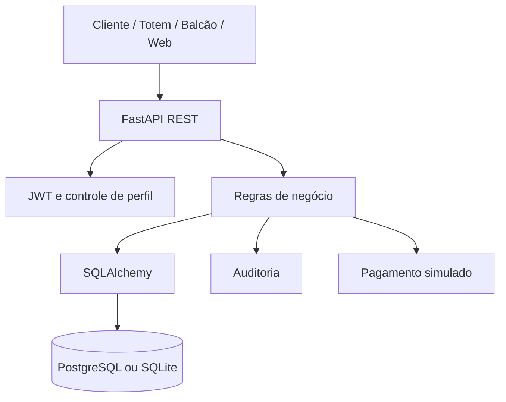
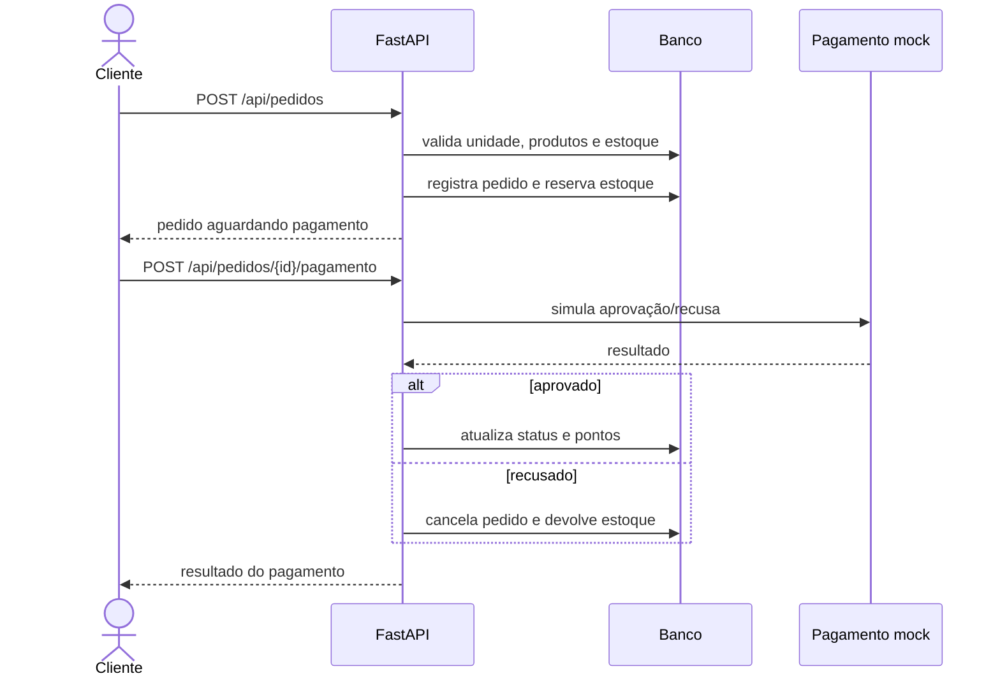

# Arquitetura do sistema

A API segue uma organização simples em camadas lógicas:

- **API (`principal.py`)**: recebe HTTP, valida entradas e monta respostas.
- **Schemas (`esquemas.py`)**: define o formato e a validação dos dados.
- **Modelos (`modelos.py`)**: representa entidades persistidas.
- **Segurança (`seguranca.py`)**: valida JWT, hash de senhas e perfis.
- **Banco (`banco_de_dados.py`)**: cria engine e sessões do SQLAlchemy.

## Fluxo principal do pedido

