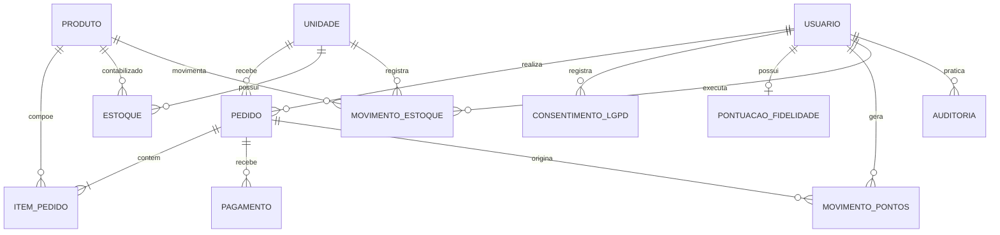

# DER conceitual

## Regras de integridade
- E-mail de usuário é único.
- Estoque tem combinação única de unidade e produto.
- Quantidade de item precisa ser maior que zero.
- Cada item guarda preço unitário histórico do momento do pedido.
- Chave de idempotência, quando informada, é única.
- Movimentos de estoque e pontos registram o motivo da operação.
